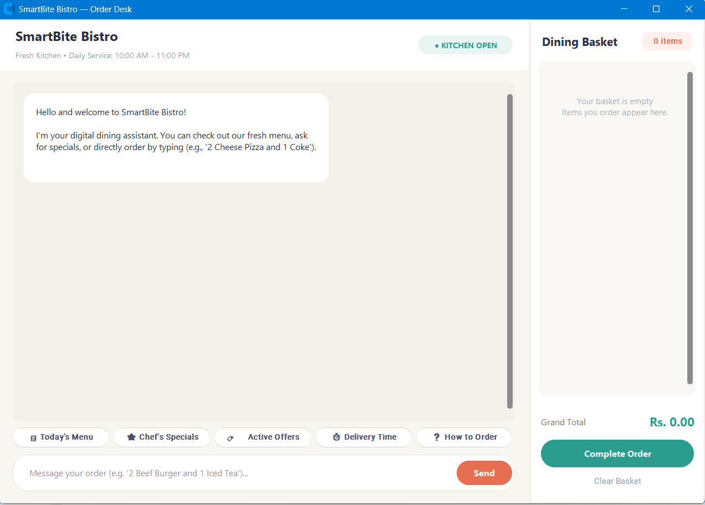
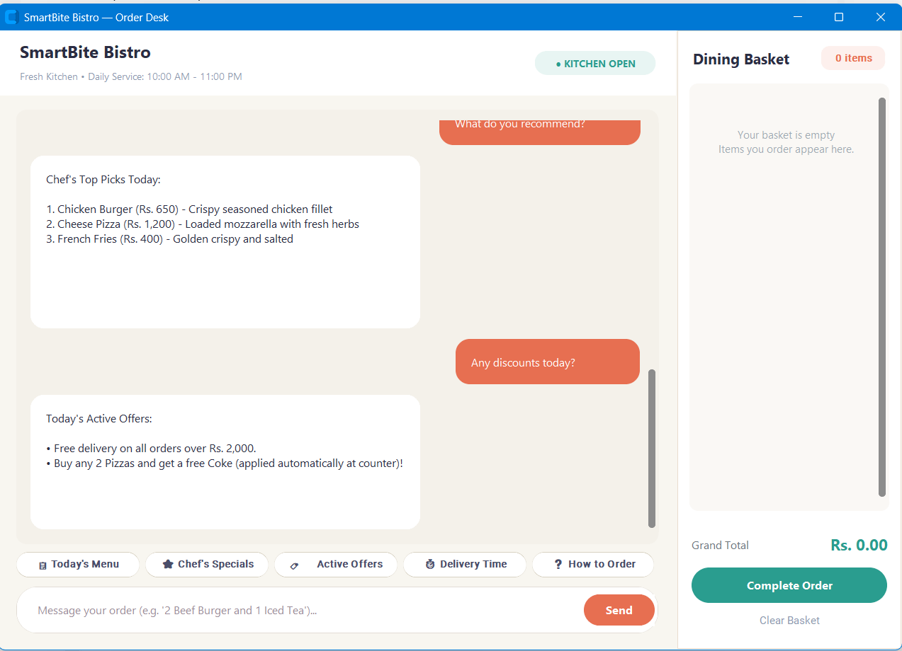
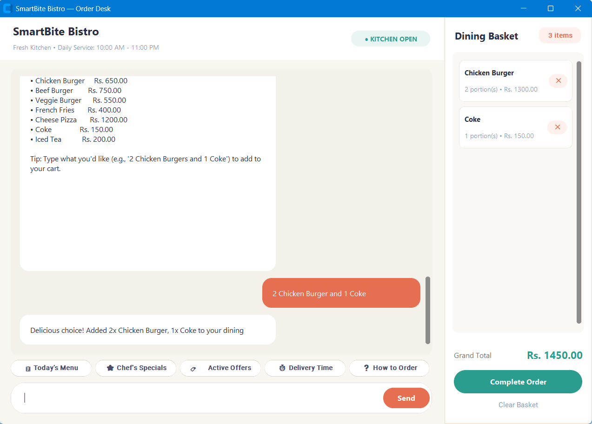
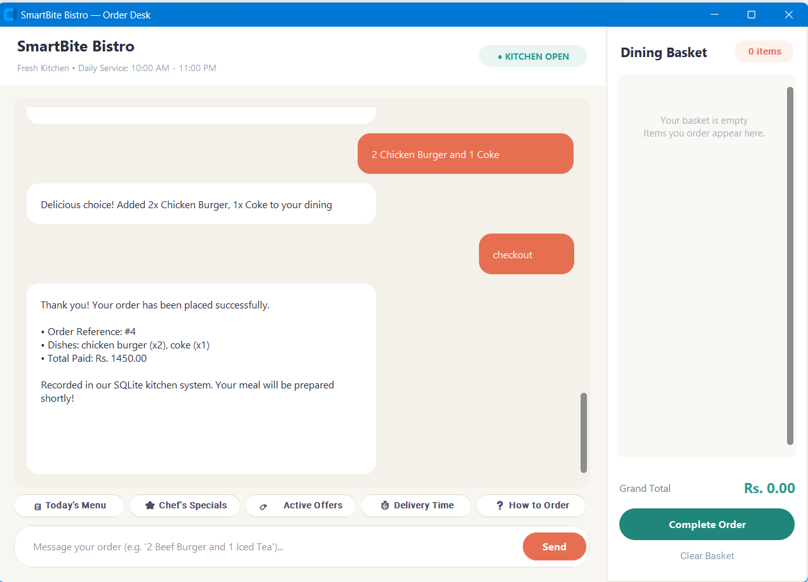

# 🍔 SmartBite Bistro — Intelligent Offline Restaurant Assistant


**SmartBite Bistro** is an offline, standalone desktop conversational ordering system built using native Python. It implements a local NLP pipeline and a rule-augmented intent classifier to assist users with dining inquiries, live menu navigation, slot-based order composition, and transaction recording—**without relying on third-party cloud APIs, external LLM endpoints, or continuous internet access**.

---

## 📸 Application Interface & Workflow

| 1. Welcome & Order Desk | 2. Daily Specials & Offers |
| :---: | :---: |
|  |  |
| *Clean initial layout with quick prompt chips* | *Context inquiries: Chef's recommendations & active offers* |

| 3. Real-Time Cart Population | 4. Checkout & Database Receipt |
| :---: | :---: |
|  |  |
| *Slot extraction parsing quantities into the live basket* | *Order reference generation & SQLite record persistence* |

---

## 🌟 Key Highlights

* **100% Offline & Private:** Runs entirely on the client CPU. No external API keys or cloud dependencies.
* **Hybrid NLP Engine:** Couples TF-IDF n-gram vectorization and multinomial Logistic Regression with deterministic regex/heuristic slot fillers to accurately parse quantities, dish variants, and removal intents.
* **Modern Desktop Interface:** Built with CustomTkinter featuring a warm bistro color scheme, character-by-character typing animations, and selectable, copy-enabled message containers.
* **Interactive Live Basket:** Real-time subtotal computation, item quantity tracking, and single-click removal controls.
* **Persistent Transaction Logging:** Integrated SQLite database schema managing restaurant menu inventories and archived customer orders.

---

## 🏗️ System Architecture

[ User Text Input ]
│
▼
[ Deterministic Entity & Quantity Parser ] (Regex & Slot Filling)
│
├──────────────────────────────────────┐
▼                                      ▼
[ Known Food Item Detected ]         [ General Inquiries ]
Forces cart addition or removal      TF-IDF Vectorizer (1-2 N-grams)
without classification drift                 │
│                                      ▼
│                            [ Logistic Regression ]
│                            Intent Classification
│                            (Greetings, Hours, Deals)
▼                                      │
[ State & Cart Session Manager ] ◄─────────────┘
│
▼
[ SQLite Engine (restaurant.db) ] ──► [ CustomTkinter UI Output ]

---

## 📦 Project Structure

```text
smartbite-restaurant-chatbot/
├── assets/                     # Application screenshots and demo media
├── intents.json                # Labeled intent classes and multi-turn patterns
├── restaurant.db               # SQLite database storing menu and receipts
├── intent_model.joblib         # Serialized vectorizer + linear classifier pipeline
├── desktop_app.py              # Main desktop GUI, event handlers, and animation loop
├── bot_engine.py               # Entity extraction, business logic, and cart state
├── database.py                 # SQLite initialization, queries, and order persistence
├── train.py                    # Model training, validation, and serialization pipeline
├── run_app.bat                 # One-click desktop launcher
└── README.md                   # Project documentation